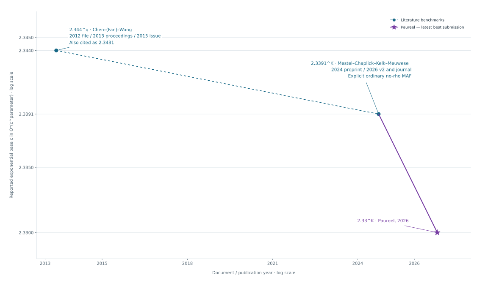

[](docs/timeline/TIMELINE.svg)

# Rooted Forest Frontier

Research on exact algorithms for **rooted maximum agreement forest (rMAF)**,
maintained by [Aurel Prosz (@Paureel)](https://github.com/Paureel).

[Timeline sources and conventions](docs/timeline/SOURCES.md) ·
[Source table](docs/timeline/timeline-data-v1.csv)

**23 October 2026: an expert-review submission is now available.** It gives
the complete mathematical argument for an exact ordinary rooted binary MAF
algorithm and a fully charged O*(2.33^k) bound on its specified log-cost RAM.
The project has internally accepted this argument with explicitly shared
formal support; outside human review is requested. This is not an end-to-end
machine-checked runtime theorem or a certified numeric/native executable.
No novelty, current-record or practical-speed claim is made.

Read the [proof](expert-review/20261023-v1/PROOF.md),
[Git source-edition instructions](expert-review/20261023-v1/GIT-SOURCE-EDITION.md),
and [verification limits](expert-review/20261023-v1/verification/VERIFICATION-LIMITS.md).
All research and monitoring remain paused. This update imports a review packet;
it does not start another campaign. The original archive, failures and initial
import status remain preserved and must be read as historical records.

## Problem and conventions

Given two rooted binary trees on the same distinct leaf labels, find a
minimum-component agreement forest. Each component must induce the same
rooted restriction in both trees, and the minimal embeddings of different
components must be vertex-disjoint in each tree. The campaign studies
ordinary rMAF: there is no implicit extra rho leaf or acyclicity condition.
For nonempty inputs, k counts components and the initial cut budget is q = k - 1.
The pinned model treats the empty state separately.
See the preserved [specification](research/rmaf/spec.json),
[algorithm target](research/rmaf/algorithm/TARGET.md), and
[target pin](research/rmaf/algorithm/PIN.md) for precise scope and exceptions.

## Start here

- [Current mathematical review record](certificates/mathematical-review-20261023-v1.json)
- [Portable proof reading map](expert-review/20261023-v1/READING-MAP.md)
- [Current status and limitations](docs/current-status.md)
- [Research map](docs/research-map.md) and [task catalogue](docs/task-catalog.json)
- [Research contribution guide](autoresearch.md)
- [Contribution requirements](CONTRIBUTING.md) and [coordination](docs/coordination.md)
- [Reproduction instructions](docs/reproducibility.md)
- [Import coverage and omitted files](docs/large-files.md)

## Local checks

The default checks require Python 3.12+, Git, make and a POSIX shell. No
BootLoops download, Lean installation, or large data file is required for this
target.

```sh
git clone https://github.com/Paureel/rooted-forest-frontier.git
cd rooted-forest-frontier
make check
```

`make check` checks the export manifest and file-size policy, then runs the
existing planted controls, deliberate comparator failure, exact recurrence
controls, and a fresh edge-cut comparison with preserved leaf-partition results.
The checks use a temporary directory and preserve the imported evidence.
Passing establishes the stated finite and packaging checks only.
GitHub Actions runs the same target on pushes and pull requests.

For the optional local dashboard, run `make setup`, `make toolkit`, then
`./bootloops-dashboard`. The dashboard reads the pinned toolkit's source index.
For historical native engines and scoped Lean replays, follow
[reproducibility](docs/reproducibility.md).

## Attribution and license

Original project contributions are under [Apache-2.0](LICENSE).
Third-party materials retain their own rights and notices; see [NOTICE](NOTICE)
and [contributors](CONTRIBUTORS.md). The collaboration structure was inspired by
[CrocSwap/integer-mult-bounds](https://github.com/CrocSwap/integer-mult-bounds).
Its mathematical work and research code are not imported into this project.
